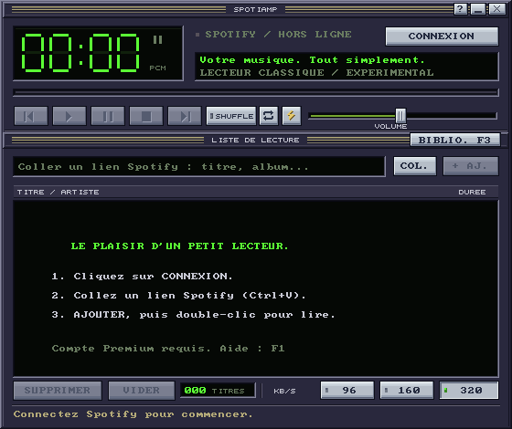

# Spotiamp — un petit lecteur Spotify classique

**L'esprit Winamp, avec une interface Windows en GDI : aucune accélération
graphique requise pour dessiner le lecteur.**

Sous Windows, Spotiamp dessine son interface en logiciel, sur le processeur,
puis l'affiche avec **GDI**, le système graphique classique de Windows.
Le rendu du lecteur ne crée aucun contexte OpenGL ou Direct3D et ne demande
pas de carte graphique dédiée. Ce choix fait partie du principe du projet :
une interface simple, un seul skin et peu de ressources mobilisées.

La différence avec Spotifast se situe aussi dans ce choix d'affichage :
[Spotifast utilise egui/eframe avec le moteur OpenGL Glow](https://github.com/crmne/spotifast/blob/e86d3de0cb72edba8f24b447218daa7f3af1f127/Cargo.toml#L31-L36),
tandis que Spotiamp utilise le rendu logiciel et GDI sous Windows.
Les [détails techniques et les mesures](PERFORMANCE.md) expliquent cette approche.

Prototype natif en Rust, inspiré de l'interface Winamp. Windows est la cible
prioritaire ; le même code vise macOS et Linux. Ce projet expérimente une
interface très sobre et plusieurs pistes de moteur audio. Le moteur actuel
est librespot 0.8 : il reste remplaçable si les mesures réelles ne conviennent pas.

**État : prototype expérimental.** Un premier essai utilisateur sous Windows
montre une session connectée, une playlist chargée et un morceau en état de
lecture. Sa capture affiche 5,7 Mo de mémoire et 0,4 % de CPU à cet instant ;
ce n'est pas une mesure de la mémoire totale ni un test de stabilité prolongé.
Les résultats et leurs limites sont dans `PERFORMANCE.md`.

**[Installer Spotiamp pour Windows](https://github.com/roukmoute/spotiamp/releases/latest/download/Spotiamp-Setup-Windows-x64.exe).**
Lancer `Spotiamp-Setup-Windows-x64.exe`, puis suivre l'assistant en français ou
en anglais. L'installation concerne votre compte, sans droits administrateur.
Le lecteur apparaît dans le menu Démarrer ; le raccourci sur le Bureau est optionnel.
L'assistant propose de lancer Spotiamp à la fin.

La version **0.1.4** reprend le **S doré du panneau À propos** pour l'icône
Windows et l'affiche aussi dans la barre des tâches et Alt+Tab.
L'installateur est proposé avec l'archive portable
`Spotiamp-Windows-x64.zip`, disponible avec les paquets Linux, macOS et les
[sources dans les releases](https://github.com/roukmoute/spotiamp/releases/latest).

La **bibliothèque de vos playlists Spotify** est accessible
en lecture seule, dans une fenêtre au style classique. **BIBLIO. F3** ou **F3**
l'ouvre : playlists et dossiers à gauche, titres de la playlist choisie à droite.
Le catalogue est chargé à l'ouverture et les titres seulement à la sélection.
Cette nouvelle découverte de bibliothèque reste à vérifier avec un compte
Spotify réel ; les essais du lecteur décrits plus haut ne la valident pas.

Le lecteur et sa bibliothèque gardent le **bandeau sans cadre système**, avec
les boutons **Réduire** et **Fermer** intégrés et le déplacement par glissement.

Les **mises à jour intégrées** restent accessibles dans l'onglet **Mise à jour**
du panneau **À propos** : détection d'une nouvelle version, téléchargement,
puis installation et redémarrage à votre demande.
Les touches métalliques, boutons enfoncés pendant l'appui, cadres encastrés et
poignées rainurées sont conservés, comme la qualité **320 kb/s par défaut** et
la molette d'un titre par cran.



L'installateur et l'archive Windows visent **Windows 10/11 x64** (processeur Intel/AMD
64 bits), conformément au [socle de la cible Rust](https://doc.rust-lang.org/rustc/platform-support.html).
Le binaire Windows et l'installateur ne sont pas signés. La CI le
compile avec le runtime C statique. L'interface
minifb utilise Win32/GDI et l'audio WASAPI. Aucun environnement Rust n'est requis
pour lancer l'exécutable. Le premier essai Windows porte sur le prototype
précédemment nommé Spool ; le paquet Spotiamp est reconstruit après renommage.

## Utilisation

1. Installer Spotiamp, puis le lancer depuis le menu Démarrer. Pour la version
   portable, décompresser le ZIP et lancer `spotiamp.exe`.
2. À la première utilisation, cliquer sur **CONNEXION**. Autoriser Spotify dans
   le navigateur, puis revenir dans le lecteur. Aux lancements suivants,
   Spotiamp tente automatiquement de réutiliser la session mémorisée.
   Aucun mot de passe n'est demandé dans Spotiamp.
3. Copier un lien Spotify de titre, d'album ou de playlist. Dans Spotiamp :
   **Ctrl+V**, puis **+ AJ.** ou Entrée.
4. Double-cliquer sur un titre. Les boutons et la barre de position pilotent
   le moteur audio local. Le client Spotify officiel peut être fermé.

Le bouton **Lecture (▶)** reprend le morceau courant à sa position lorsqu'il
est en pause. S'il est déjà en lecture, il revient au début de ce même morceau.
Ces actions conservent le titre chargé, même si une autre ligne est sélectionnée,
ainsi que sa qualité audio. Après **Arrêt**, le bouton démarre le titre sélectionné
(sinon le titre courant, ou le premier titre de la file).
Un double-clic sur une ligne ou **Entrée** lance explicitement ce titre depuis
le début. **Pause (Ⅱ)** et **Espace** alternent entre pause et reprise.

Les boutons **Shuffle** et **Repeat (↻)** se trouvent après **Suivant**.
Un voyant vert indique qu'un mode est actif ; cliquer à nouveau le désactive.
**Shuffle** parcourt les titres dans un ordre mélangé, sans rejouer une entrée
pendant le même tour. **Précédent** permet de revenir dans cet ordre.
**Repeat** relance la file lorsqu'elle se termine ; avec Shuffle, un nouvel
ordre est préparé à chaque tour. Sans Repeat, la lecture s'arrête à la fin.
Avec un seul titre et Repeat activé, ce titre joue en boucle.
Les deux modes sont désactivés au lancement et n'altèrent pas vos playlists Spotify.

Pour retrouver vos playlists sans copier de lien, ouvrir **BIBLIO. F3** après
la connexion. La fenêtre affiche les playlists enregistrées ou suivies de votre
compte, avec leur dossier en sous-titre. Cliquer sur une playlist charge ses
titres ; **Actualiser** ou **F5** recharge le catalogue Spotify.

**Lire** remplace la file par la playlist chargée et démarre le titre sélectionné,
ou le premier titre si aucune ligne n'est sélectionnée. Le remplacement n'a lieu
qu'après le chargement réussi de la liste de titres : une erreur d'accès ou une
playlist vide conserve la file précédente. Le double-clic sur un titre utilise
la même action en démarrant à cette ligne. **À la file** ajoute la playlist à la
file existante sans remplacer son contenu ni lancer une nouvelle lecture.

La playlist affichée et la file sont limitées à **500 titres accessibles**.
Si la file contient déjà des titres, **À la file** ajoute seulement ce que les
places restantes permettent ; un message indique la limitation. Les noms,
artistes et durées arrivent progressivement, avec deux requêtes de métadonnées
simultanées au maximum. La bibliothèque ne modifie aucune playlist sur Spotify.
Le catalogue est plafonné à **1 000 playlists** et **2 000 entrées** en comptant
les marqueurs de dossiers ; un dépassement est signalé au lieu de charger une
liste partielle silencieusement.

Dans la bibliothèque, **Tab** ou **Gauche/Droite** change de panneau ;
**Haut/Bas**, **Début/Fin** et **Page précédente/suivante** parcourent les lignes.
**Entrée** lance la lecture, **Ctrl+Entrée** ajoute à la file, et la molette
déplace d'une ligne par cran le panneau survolé. **F3**, **Échap** ou la croix
ferme cette fenêtre. La lecture du lecteur continue ; les données de bibliothèque
et son buffer graphique sont relâchés à la fermeture.
Les touches **Ctrl**, **F3** et les **flèches** sont réinitialisées aux changements
de focus entre les deux fenêtres. Sous Linux, restaurer une fenêtre réduite
réaffiche l'image conservée, même si son contenu n'a pas changé. La fermeture
libère aussi les ressources natives de la fenêtre.

Les boutons s'activent au relâchement de la souris dans le bouton pressé.
Relâcher à l'extérieur annule le clic ; une perte de focus annule aussi l'appui.
Les barres de volume et de position réagissent dès l'appui et pendant le glissement.

Pour déplacer la fenêtre, maintenir le bouton gauche de la souris sur une zone
libre du bandeau supérieur et la faire glisser. **Réduire** et **Fermer**, à
droite du bandeau, remplacent les boutons du cadre système. **Alt+F4** continue
de fermer le lecteur sous Windows. La fenêtre garde une taille fixe, à
l'échelle **1×** ou **2×** avec `--scale 2` ; la maximisation est désactivée.

Le bouton **À propos**, près du volume, ou **F2** ouvre un panneau à cinq
onglets : **Spotiamp**, **Crédits**, **Raccourcis**, **Historique** et **Mise à jour**.
**Projet GitHub** ouvre le dépôt dans le navigateur du système.
**Copier les infos** copie la version, le système, l'architecture, le moteur et
la qualité préférée ; ces informations ne contiennent aucune donnée de compte.
Un message confirme la copie ou signale une erreur d'accès au presse-papiers
ou d'ouverture du navigateur.

Dans ce panneau, **Tab/Maj+Tab** parcourt les onglets et boutons, les quatre
**flèches** changent d'onglet et **Entrée/Espace** active le contrôle sélectionné.
**F1** affiche les raccourcis ; **F2**, **Échap**, la croix ou **Fermer** ferment
le panneau. La lecture continue pendant sa consultation ; les commandes du
lecteur restent bloquées derrière le panneau.

Une recherche de mise à jour commence trois secondes après le lancement, une
seule fois par session. À partir de la version **0.1.0**, seules les versions
stables sont proposées ; les releases du projet sont publiées sans le statut
« pre-release ».
La recherche ne propose qu'un paquet
compatible avec le système et l'architecture du lecteur. Une notification
persistante et un repère sur le bouton **À propos** signalent une version
disponible ; **F2** ouvre alors directement l'onglet **Mise à jour**.

Dans cet onglet, **Vérifier** relance la recherche. **Télécharger** récupère le
paquet sur disque et vérifie son empreinte SHA-256 ; la lecture peut continuer.
Lorsque le paquet est prêt, **Installer / Redémarrer** ferme le lecteur,
remplace l'exécutable puis le relance. **La lecture s'arrête et la file est
perdue**, car elle n'est pas encore sauvegardée. Les identifiants Spotify déjà
mémorisés dans le coffre du système et la qualité préférée sont conservés.
Un échec s'affiche dans le panneau. Le dossier du programme doit être accessible
en écriture pour l'installation. `--no-update-check` désactive la recherche
automatique au démarrage ; **Vérifier** reste disponible.

L'installateur utilise par défaut `%LOCALAPPDATA%\Programs\Spotiamp` : les mises
à jour intégrées peuvent y remplacer les fichiers sans élévation. Il n'ajoute
aucun service, lancement automatique ni processus résident. Le **S doré** du
panneau À propos et les informations de version sont intégrés à l'exécutable.
Le lecteur et sa bibliothèque utilisent cette même icône pour leurs fenêtres,
la barre des tâches et Alt+Tab, sans fichier d'image externe à charger.
Les raccourcis continuent
de fonctionner après une mise à jour ; la version dans les paramètres Windows
est actualisée au lancement du lecteur installé.

Pour désinstaller, utiliser **Paramètres Windows → Applications → Spotiamp →
Désinstaller**. Fermer le lecteur avant une installation ou désinstallation.
Les réglages dans `%APPDATA%\Spotiamp` et les identifiants du coffre Windows sont
conservés ; **DECONNECTER** dans le lecteur permet d'effacer ces identifiants.
Les fichiers personnels ajoutés à la racine du dossier d'installation sont
conservés. Les sous-dossiers `licenses`, `mpl-source` et `scripts` appartiennent
au programme et sont supprimés intégralement, y compris les fichiers apportés
par les mises à jour ; ne pas y ranger de données personnelles.

L'installation réutilise les réglages et la connexion mémorisée d'une ancienne
copie portable. Elle ne supprime pas cette copie et ne migre pas une file de
lecture en cours, qui n'est pas sauvegardée.

Les boutons **96 / 160 / 320**, à côté de **KB/S** sous la liste, règlent la
qualité demandée. Le choix est mémorisé et appliqué au prochain chargement de
titre : le morceau en cours continue sans coupure. Pour l'appliquer immédiatement,
relancer le morceau par double-clic (il reprend au début). Pause/reprise et
déplacement dans le morceau conservent la qualité de son chargement initial.

**320 kb/s** est le maximum du moteur intégré actuellement ; le mode Spotify
sans perte n'est pas pris en charge. Le moteur peut choisir un format de repli
si le débit demandé n'existe pas pour ce titre. La barre d'état indique donc la
**qualité demandée**, pas une mesure du débit réel. Le réglage est enregistré
dans `%APPDATA%/Spotiamp/audio-quality` sous Windows,
`~/Library/Application Support/Spotiamp/audio-quality` sous macOS et
`$XDG_CONFIG_HOME/Spotiamp/audio-quality` (sinon `~/.config/Spotiamp/audio-quality`)
sous Linux. Ce petit fichier ne contient aucun identifiant.

Le débit réseau audio nominal passe de 160 à 320 kb/s. Cela ne signifie pas que
la RAM double ; l'impact sur les buffers et le décodage reste à mesurer en lecture
réelle. Aucun nouveau moteur, processus ou préchargement n'est ajouté.

Le compte doit avoir Spotify Premium. La session est mémorisée dans le coffre
du système : Gestionnaire d'identifiants Windows, Trousseau macOS ou Secret
Service Linux. Si ce service est indisponible, la connexion reste limitée à
la session courante ; il n'y a pas de repli vers un fichier de jetons en clair.
La connexion est annoncée après la sauvegarde de la session, ou avec un message
si la sauvegarde n'a pas pu être confirmée.
Fermer la fenêtre conserve cette session : au prochain lancement, une tentative
de reconnexion s'effectue en arrière-plan, sans démarrer la musique.
Si aucune session n'est enregistrée, si le coffre est inaccessible ou si la
reconnexion échoue, le navigateur ne s'ouvre pas automatiquement ; le bouton
**CONNEXION** reste disponible. Un échec réseau n'efface pas la session mémorisée.
**ANNULER** interrompt une tentative de connexion sans oublier le compte.
**DECONNECTER** supprime les identifiants mémorisés : après effacement réussi,
la reconnexion automatique n'aura plus lieu au lancement suivant. Le navigateur du système
sert à l'autorisation Spotify et au lien **Projet GitHub** du panneau À propos ;
il n'est pas embarqué dans le lecteur.

Les liens acceptés sont `https://open.spotify.com/track/...`, `/album/...`,
`/playlist/...`, y compris les URL `intl-fr`, et les URI `spotify:track:...`,
`spotify:album:...`, `spotify:playlist:...`. Les liens raccourcis ne sont pas
résolus. Les playlists sont limitées aux titres accessibles renvoyés par Spotify.

Raccourcis du lecteur : Espace lecture/pause, flèches sélection, Entrée lecture
ou ajout, Suppr retirer, Tab champ de lien, F1 aide, F2 À propos, F3 bibliothèque, Échap fermer
l'aide ou le panneau. Sous macOS, Cmd+V colle également un lien. Le texte utilise
une petite police bitmap : les glyphes absents sont affichés avec `?`.

## Choix pour limiter la mémoire

- Rendu logiciel bitmap sur le CPU, affichage **Win32/GDI sous Windows**,
  sans dépendance à l'accélération 3D pour l'interface du lecteur.
- Un seul thème, aucune WebView ni moteur de navigateur.
- Un processus pendant la lecture ; le réseau et l'audio restent hors du thread
  d'interface. Un processus temporaire remplace l'exécutable lors d'une mise à jour.
- Recherche de mise à jour ponctuelle, sans thread ni client HTTP gardé au repos.
  Téléchargement sur disque et progression affichée dans le buffer existant.
- Pas de pochettes, de visualiseur, de cache audio persistant ni de téléchargement
  des titres de toutes les playlists. Le catalogue de playlists est paginé,
  et une seule playlist est chargée pour l'affichage à la fois.
- Fenêtre de bibliothèque créée uniquement à son ouverture. Son framebuffer,
  le catalogue et les titres affichés sont relâchés à la fermeture ; la file
  du lecteur reste indépendante. Les données partagées utilisent des `Arc` et
  une révision évite de recopier ou parcourir les titres à chaque image.
- File limitée à 500 titres, deux requêtes de métadonnées simultanées.
- Buffer graphique réutilisé ; rendu seulement lorsque l'état visible change.
- Pas de préchargement du morceau suivant ; cela peut introduire un silence
  entre les titres. Les buffers internes de librespot ne sont pas tous bornés
  par Spotiamp ; une grande réponse de playlist peut causer un pic temporaire.
- Un worker asynchrone pour le moteur, plus son thread de lecture et les
  threads nécessaires aux chargements et à la sortie audio. Ce plafond est
  documenté dans `vendor/librespot-playback/PATCH.md`.

Le lecteur comprend connexion, import par lien, bibliothèque de playlists Spotify,
file, lecture locale, pause, arrêt, précédent/suivant, volume et déplacement dans
le titre. Il n'inclut pas encore recherche de catalogue, vue albums/artistes/titres
likés, égaliseur,
skins `.wsz`, lecture hors ligne, icône de notification, touches multimédia
globales ni sauvegarde de la file. L'accessibilité et la saisie complexe sont
limitées par cette interface bitmap.
Un déplacement dans le titre peut laisser entendre brièvement les données
déjà présentes dans le petit buffer de sortie.

Ce client utilise une intégration Spotify non officielle ; une modification
du service peut interrompre son fonctionnement. Il n'est affilié ni à Spotify
ni à Winamp. Le graphisme est dessiné dans le code ; aucun fichier de skin
Winamp n'est redistribué.

## Compiler

Installer Rust avec rustup et les outils natifs de compilation. Le fichier
`rust-toolchain.toml` fixe Rust **1.95.0**, avec rustfmt et Clippy.

```sh
cargo build --release --locked --bin spotiamp
cargo test --locked
cargo test --locked -p librespot-playback --lib quality_tests
```

Les tests du défilement couvrent l'accès aux titres entre deux vues, les crans,
les fractions, les rafales et les limites de liste. Sous Windows, `cargo test`
injecte aussi des événements de molette natifs dans une fenêtre de test.
Les tests de qualité couvrent la persistance, la conservation du flux en cours,
la demande liée à chaque chargement et l'invalidation du précédent flux quand
le débit change. Ils fonctionnent hors ligne ; le débit servi par Spotify doit
encore être vérifié pendant une lecture authentifiée.
Le test X11 demande un écran virtuel et `xdotool` et se lance explicitement :

```sh
LC_ALL=C XMODIFIERS=@im=none xvfb-run -a cargo test --locked --bin spotiamp x11_wheel_press_and_release_count_as_one_notch -- --ignored
```

Les tests d'interface vérifient les états visuels pressé/relâché, l'annulation
hors bouton, les contrôles désactivés et la perte de focus. Ceux du panneau
À propos couvrent les onglets, la navigation clavier, les boutons et le blocage
des interactions avec le lecteur en arrière-plan. Ceux des mises à jour couvrent
les états et actions disponibles, la capture souris et le rendu sans remplacer
le buffer graphique. Un appui sur **Télécharger** ne devient pas un clic sur
**Installer** si l'état change avant le relâchement. Les tests natifs Windows et
X11 injectent aussi des clics courts et vérifient leurs coordonnées en taille
double. La CI exécute les tests X11 dans Xvfb, avec `xdotool`.

Les tests de bibliothèque utilisent des données synthétiques : sélection et
défilement dans chaque panneau, changements de liste pendant un chargement,
double-clic sur le bon titre, commandes désactivées et conservation du framebuffer.
Ils ne remplacent pas un essai authentifié de découverte des playlists et de
lecture Spotify.

Windows : Rust avec la cible `x86_64-pc-windows-msvc` et les outils de compilation
Visual Studio C++. macOS : outils Xcode. Linux Debian/Ubuntu :

```sh
sudo apt install build-essential pkg-config libasound2-dev libdbus-1-dev libx11-dev libxcursor-dev libxrandr-dev
```

Linux utilise X11, ou XWayland dans une session Wayland. L'audio passe par
Rodio/CPAL : WASAPI sous Windows, CoreAudio sous macOS, ALSA sous Linux.
La connexion OAuth écoute temporairement sur `127.0.0.1:5588`.

```sh
cargo run --release -- --scale 2
# Interface seule : lecture et mises à jour désactivées dans ce binaire.
cargo build --release --no-default-features --bin spotiamp
# Initialisation du moteur hors ligne, sans morceau ni sortie sonore réelle.
cargo run --release --bin engine_probe
```

Le workflow `.github/workflows/build.yml` automatise les tests et artefacts sur
les trois systèmes. Les tests ont réussi sur Windows x64, Linux x64 et macOS
Apple Silicon lors de la [première exécution](https://github.com/roukmoute/spotiamp/actions/runs/39630012360).
La compilation Windows MSVC du workflow utilise le runtime C statique
(`-C target-feature=+crt-static`).
Les scripts `measure-windows.ps1` et `measure-linux.py` enregistrent les mesures
brutes ; une étiquette `playing` ne prouve pas qu'une musique joue réellement.

## Licences

Code Spotiamp : MIT. Les dépendances gardent leurs licences propres. Le paquet
binaire inclut leurs notices ainsi que les sources exactes des composants MPL
concernés. `Cargo.lock` fixe les versions pour reconstruire le programme.
